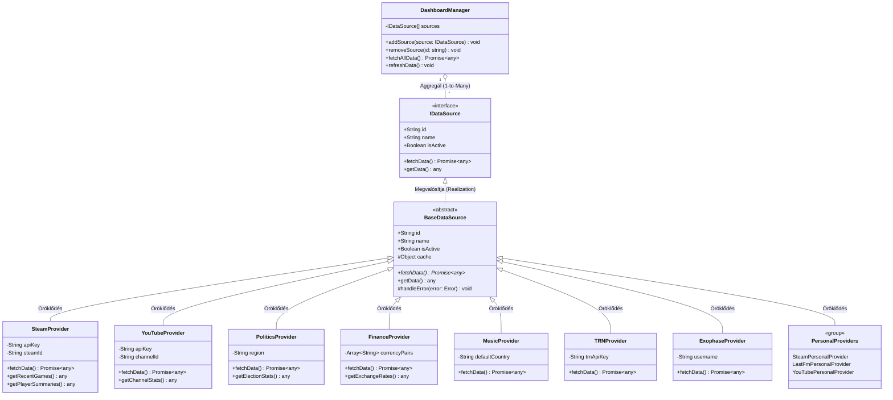

## 3. Osztálydiagram (Class Diagram)
Részletes UML diagram a **Strategy Pattern** (Stratégia Tervezési Minta) megvalósításáról. Professzionális OOP kapcsolatokkal (Aggregáció, Megvalósítás, Öröklődés) és kardinalitással bővítve.

