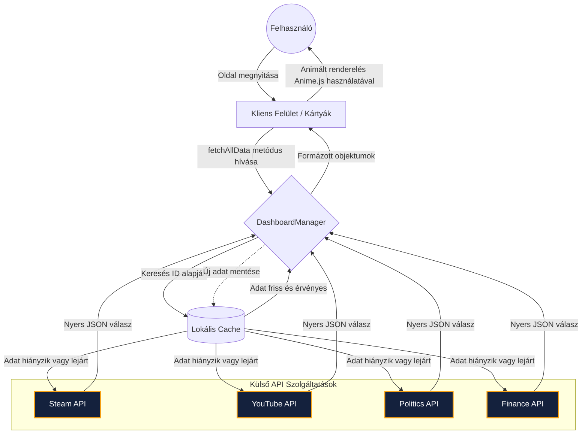

## 2. Adatlekérési Folyamat (Flowchart)
Ez az ábra bemutatja az adatáramlás teljes életciklusát: a felhasználói interakciótól kezdve a lokális gyorsítótárazáson (cache) át a külső API-kig, majd vissza a UI-hoz.

